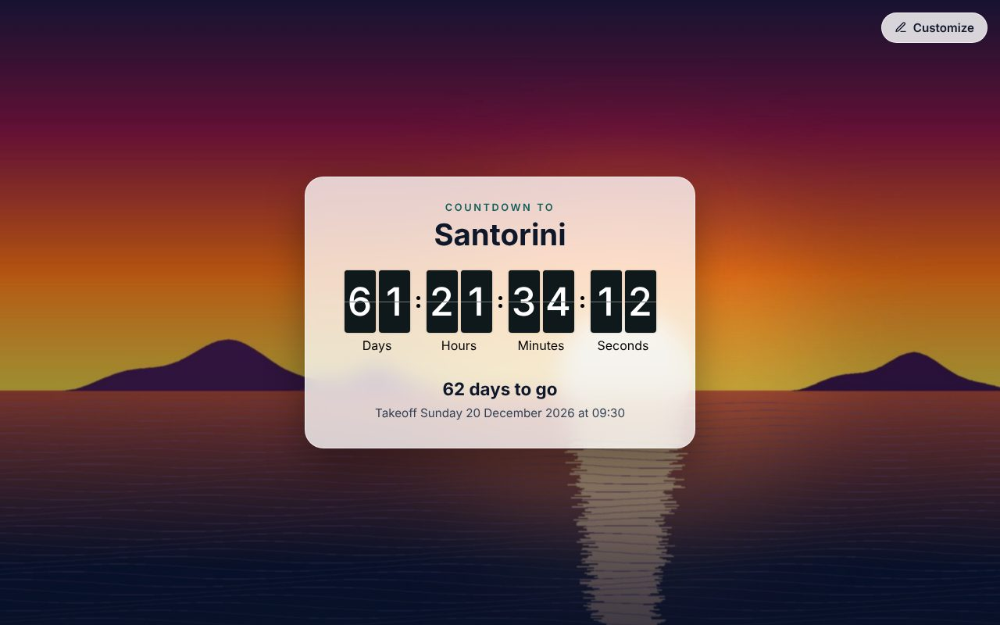
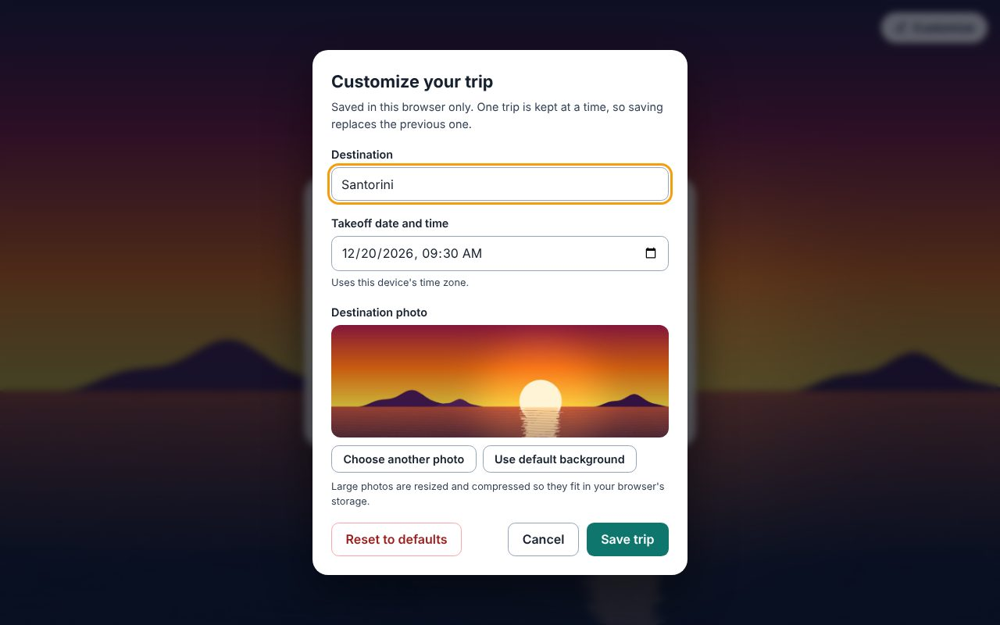
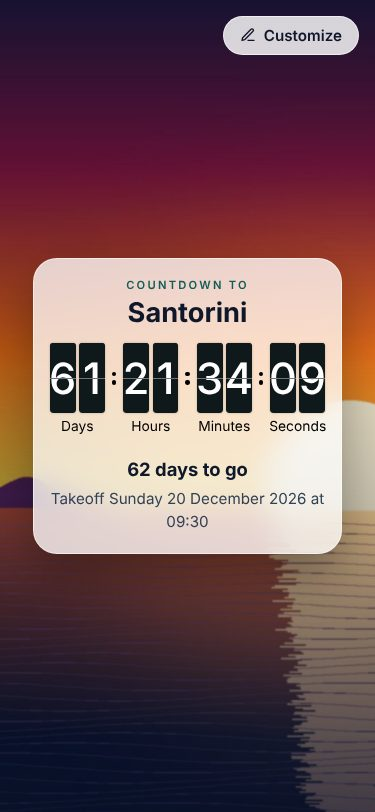

# Trip Countdown

A flip clock countdown to your next trip, made to be yours. Choose a destination, add your own photo and set the takeoff date and time. Everything is saved in your browser, so the countdown is waiting for you every time you come back. There is no account and no backend, and nothing ever leaves your device.



## Features

- **Flip clock countdown** to the second, with a plain "62 days to go" line and the exact takeoff time underneath.
- **Make it yours.** Set the destination name, the takeoff date and time, and a background photo. Without a photo you get a gradient.
- **Remembers your trip.** Saved in `localStorage`, one trip at a time. Saving a new trip replaces the old one.
- **Photos just work.** Big phone photos are resized and compressed in the browser so they fit in storage. No upload to any server.
- **Tab title and favicon follow the destination**, so a pinned tab says where you are headed.
- **Confetti when takeoff arrives**, and a "Plan your next trip" button once it has.
- **Responsive and accessible.** Works from 320 px phones to wide desktops, keyboard friendly, respects reduced motion, and screen readers get a calm hourly summary instead of a ticking clock.
- **Tiny and static.** One small bundle that you can host anywhere.

<p>
  
  
</p>

## How customization works

Open **Customize** in the top right corner.

| Setting | Notes |
| --- | --- |
| Destination | Up to 50 characters. Shown in the heading, the browser tab title and the favicon. |
| Takeoff date and time | Read in your device's time zone and stored as an exact UTC instant, so the countdown stays correct if you travel. |
| Photo | Upload an image, or keep the default gradient. |

Details worth knowing:

- **Where it is stored:** your browser's `localStorage`, under the key `tripCountdown:v1`. It stays on this browser on this device. Clearing site data erases it, and it does not sync between devices.
- **One trip only:** there is a single saved set. Saving replaces it, and **Reset to defaults** deletes it.
- **Photo handling:** uploads are scaled down to at most 1920 px on the long side and re-encoded as JPEG (quality is lowered if needed) so they stay well inside the roughly 5 MB browser storage limit. Even a 28 MB, 24 megapixel worst-case test image shrinks to about 1.2 MB. Transparent PNGs are flattened onto white. HEIC photos may not open in every browser; JPEG, PNG and WebP always do.
- **When something goes wrong:** if storage is full or blocked, you get a message and your previous trip is left untouched. If stored data is missing or corrupt, the app quietly shows the sample countdown.
- **Before you save anything,** the page shows a sample countdown 30 days away so it never opens on a finished clock.

## Tech stack

- [React 19](https://react.dev) and [TypeScript](https://www.typescriptlang.org)
- [Vite 7](https://vite.dev)
- [@leenguyen/react-flip-clock-countdown](https://github.com/leenguyen/react-flip-clock-countdown) for the flip clock
- [react-confetti](https://github.com/alampros/react-confetti) for the takeoff celebration
- [date-fns](https://date-fns.org) for date formatting and [react-use](https://github.com/streamich/react-use) for a few hooks

## Getting started

You need Node.js 20.19 or newer (or 22.12 or newer).

```bash
npm install
npm run dev        # start the dev server with hot reload
npm run build      # type-check and build to dist/
npm run preview    # serve the production build locally
npm run lint       # run ESLint
npm run verify     # lint, then build: run this before pushing
```

## Project structure

```text
src/
  App.tsx            the page: background, card, flip clock, confetti
  SettingsPanel.tsx  the Customize dialog
  tripSettings.ts    saved trip: types, defaults, localStorage, useTripSettings hook
  imageUtils.ts      in-browser photo resize and compression
  pageMeta.ts        browser tab title and favicon
  App.css            keyframes, focus styles and other things inline styles cannot do
public/              the default favicon
docs/                README screenshots
```

## Deploying

The build is plain static files in `dist/`, and the app has a single page with no client-side routing, so no rewrite rules are needed. Upload `dist/` to any static host such as Amazon S3 with CloudFront, Netlify, Vercel or GitHub Pages.

## License

The code is released under the [MIT License](LICENSE).

No third-party photos are bundled. The screenshots above use a generated image, and any photo you upload stays in your own browser.
